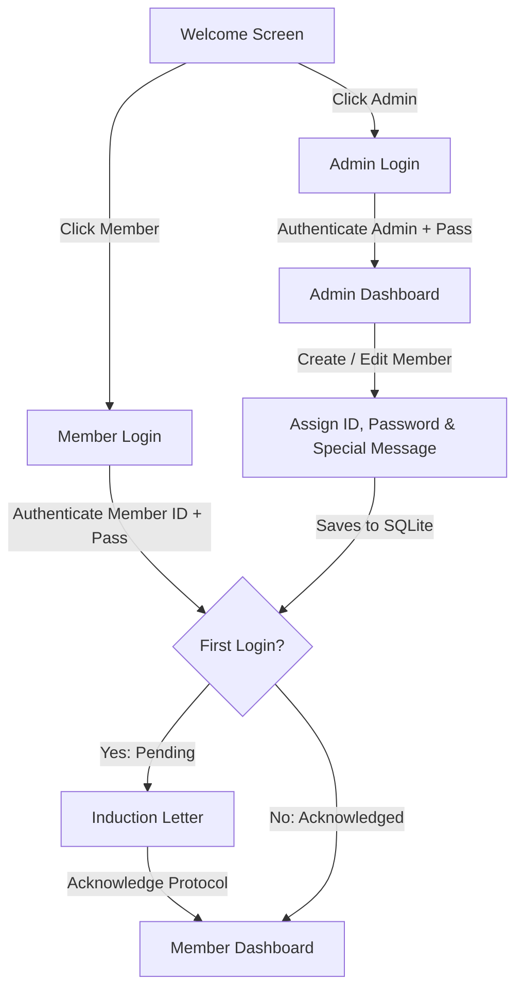

# GOTHAM COLLAGE — Architecture & Developer Guide

## 1. High-Level Overview
**Gotham Collage** is a venture studio member portal and authentication application built with:
- **Frontend**: React 18, Vite, Tailwind CSS, Lucide Icons, html2canvas, and jsPDF.
- **Backend**: Node.js, Express, Native SQLite (`node:sqlite`), HTTP-only secure cookie sessions, Scrypt password hashing with cryptographic salt and timing-safe comparison.
- **Assets**: Organized asset directory for images, audio, and video media streaming.

---

## 2. Directory Structure
```text
gotham-collage/
├── data/
│   └── gotham.db                  # Embedded SQLite database (members, sessions, audit, announcements)
├── public/
│   └── assets/                    # Public media assets (served at /assets/)
│       ├── images/                # Static images, logos, wallpapers, icons
│       │   ├── gotham-logo.jpg    # Studio crest / official logo
│       │   ├── gotham-tower.png   # Gotham Tower background
│       │   └── README.md          # Image formats & usage guide
│       ├── audio/                 # Sound effects, ambient tracks, voiceovers
│       │   └── README.md          # Audio formats & usage guide
│       └── video/                 # Background loops, cinematic reels, video clips
│           └── README.md          # Video formats & usage guide
├── server/
│   ├── auth.js                    # Password hashing (Scrypt), session lifecycle, auth middleware, audit logs
│   ├── db.js                      # SQLite database connection, table schemas, migration checks
│   ├── index.js                   # Express REST API, static asset server, SPA routing
│   └── seed.js                    # Initial demo accounts & data initialization
├── src/
│   ├── components/                # React UI Components
│   │   ├── index.js               # Clean barrel export for all screens and components
│   │   ├── WelcomeScreen.jsx      # Entry landing (Member vs. Admin selection)
│   │   ├── MemberLogin.jsx        # Member ID & password authentication screen
│   │   ├── AdminLogin.jsx         # Admin credentials authentication screen
│   │   ├── InductionLetter.jsx    # Formal induction document (PDF download & sign-off)
│   │   ├── MemberDashboard.jsx    # Authenticated member view (tower background, greeting, announcements)
│   │   ├── AdminDashboard.jsx     # Member registry management, induction messages, announcements
│   │   └── Navbar.jsx             # Minimal top bar (active on Admin dashboard)
│   ├── constants/
│   │   └── assets.js              # Centralized media paths manifest (images, audio, video)
│   ├── context/
│   │   └── AuthContext.jsx        # Global authentication state, routing logic, session checks
│   ├── App.jsx                    # Root application entry and view router
│   ├── index.css                  # Tailwind directives and custom parchment styling
│   └── main.jsx                   # React DOM mounting
├── dist/                          # Production-ready client bundle
├── package.json                   # Dependencies & scripts
└── vite.config.js                 # Vite bundler configuration
```

---

## 3. Media Assets Organization (`public/assets/`)
All files stored inside `public/assets/` are automatically served with **HTTP 206 Partial Content (range requests)** enabled, permitting instant streaming and seeking for audio and video:

| Folder | Recommended Formats | Served At URL | Code Example |
| :--- | :--- | :--- | :--- |
| **`public/assets/images/`** | `.png`, `.jpg`, `.jpeg`, `.webp`, `.svg` | `/assets/images/<file>` | `` |
| **`public/assets/audio/`** | `.mp3`, `.wav`, `.ogg`, `.m4a` | `/assets/audio/<file>` | `<audio src="/assets/audio/ambient.mp3" controls />` |
| **`public/assets/video/`** | `.mp4`, `.webm`, `.mov` | `/assets/video/<file>` | `<video src="/assets/video/skyline.mp4" autoPlay loop muted playsInline />` |

---

## 4. Authentication & State Lifecycle


1. **Member Login**:
   - Members authenticate with **Member ID** (e.g. `GC-DES-001`) and **Password**.
   - Verified via `scryptSync` with timing-safe comparison.
   - An HTTP-only session cookie (`gotham_session`) is returned.
2. **First-Login Protocol**:
   - If `has_acknowledged_welcome === 0`, member is directed to the formal **Induction Letter** displaying **"A Special Message from Admin"**.
   - Clicking "Continue to Profile" commits an acknowledgment to the database.
3. **Admin Portal**:
   - Administrators authenticate with `admin` / `gotham2026!`.
   - Admin can create new members, assign their credentials, and write their **Special Message from Admin**.

---

## 5. REST API Reference

### Authentication
- `POST /api/auth/login` — Member authentication with `{ member_id, password }`.
- `POST /api/auth/admin-login` — Admin authentication with `{ username, password }`.
- `GET /api/auth/me` — Verify active session token from cookie.
- `POST /api/auth/acknowledge-welcome` — Mark induction letter as acknowledged.
- `POST /api/auth/logout` — Invalidate session token and clear cookie.

### Admin Operations
- `GET /api/admin/members` — Retrieve all registered members.
- `POST /api/admin/members` — Create a new member `{ member_id, full_name, password, induction_message }`.
- `PUT /api/admin/members/:member_id` — Update member details, password, or special induction message.
- `DELETE /api/admin/members/:member_id` — Remove member from studio registry.
- `POST /api/admin/members/reset-welcome` — Reset first-login status to trigger induction letter again.

### Announcements
- `GET /api/announcements` — Retrieve public announcements.
- `POST /api/admin/announcements` — Publish an announcement.
- `DELETE /api/admin/announcements/:id` — Remove an announcement.

---

## 6. Running & Building
- **Start Backend**: `node server/index.js` (Runs Express server on port `5000`).
- **Build Frontend**: `npm run build` (Compiles React app with Vite to `dist/`).
- **Development**: `npm run dev` (Vite hot module reloading on port `5173`).
